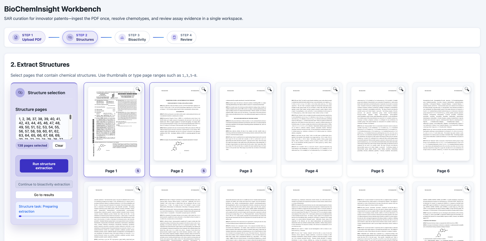

# BioChemInsight

Extracts chemical structures and bioactivity data from scientific PDFs (patents and journal articles) and merges them into structured CSV/Excel datasets.



## What It Does

- Detects structure pages, bioactivity pages, and assay names automatically; explicit page ranges also supported.
- Converts chemical diagrams to SMILES (DECIMER Segmentation + MolNexTR Mixture-of-Experts, with Markush/fragment sidecar experts and confidence-gated visual re-verification). Markush scaffolds with detached fragments are assembled into complete molecules.
- Reads compound identifiers per structure with a vision-language model (recommended: **GLM-4.5V**; any OpenAI-compatible model via `VISUAL_MODEL_NAME` / `VISUAL_MODEL_URL` / `VISUAL_MODEL_KEY` in `constants.py`).
- Extracts bioactivity values (IC50, EC50, Ki, ...) with PaddleOCR + language models. Only experimentally measured values are kept; docking scores and in-silico predictions are excluded.
- Handles literature series (structure drawn once, activity listed per member): series identifiers expand to member level and member structures are resolved from names via PubChem/OPSIN.
- Merges structures and bioactivity on compound IDs.
- Web UI (React + FastAPI) with progress tracking, and a CLI for batch runs.

## Installation

### Docker (recommended)

Requires Docker with GPU support (NVIDIA Container Toolkit); ~2 GB of model weights are downloaded during build.

```bash
git clone https://github.com/dahuilangda/BioChemInsight
cd BioChemInsight
mv constants_example.py constants.py   # then edit API keys and model endpoints
mkdir -p data output frontend/backend/data
docker compose up --build -d
```

- UI: `http://localhost:3000` — API: `http://localhost:8000`
- PaddleOCR runs as a separate microservice: build it from `DOCKER_PADDLE_OCR` and set `PADDLEOCR_SERVER_URL` in `constants.py`.
- Optional build arg: `ZENODO_HOST`
- To run different MolNexTR weights than those baked into the image, mount them and set `MOLNEXTR_MODEL_PATH` to the full file path. (proxy for downloading DECIMER weights when zenodo.org is unreachable). `APP_UID`/`APP_GID` are runtime environment variables for the entrypoint, not build args.

### Manual

```bash
conda create -n chem_ocr python=3.12
conda activate chem_ocr

pip install torch torchvision --index-url https://download.pytorch.org/whl/cu129
pip install SmilesPE opencv-python-headless PyMuPDF PyPDF2 openai Levenshtein \
    mdutils tabulate python-multipart fastapi uvicorn celery redis huggingface_hub py2opsin
mamba install -c conda-forge jupyter pytesseract transformers
sudo apt-get install -y redis-server nodejs   # macOS: brew install redis node
```

Weights (hosted on the HuggingFace dataset [dahuilangda/BioChemInsight](https://huggingface.co/datasets/dahuilangda/BioChemInsight); the GitHub repo ships none):

```bash
huggingface-cli download dahuilangda/BioChemInsight --repo-type dataset \
    --local-dir /tmp/bci_weights --local-dir-use-symlinks False
mkdir -p models experiments/moe/production
mv /tmp/bci_weights/molnextr_best.pth models/
mv /tmp/bci_weights/moe/* experiments/moe/production/
```

# China mirror: export HF_ENDPOINT=https://hf-mirror.com before downloading


| File | Size | Target Path |
|------|------|-------------|
| `molnextr_best.pth` | 1.1 GB | `models/molnextr_best.pth` |
| `moe/moe_encoder.pth` | 322 MB | `experiments/moe/production/` |
| `moe/moe_expert1.pth` | 32 MB | `experiments/moe/production/` |
| `moe/moe_expert2.pth` | 32 MB | `experiments/moe/production/` |
| `moe/moe_router.pt` | 38 MB | `experiments/moe/production/` |
| `moe/moe_confidence.pt` | 1.3 MB | `experiments/moe/production/` |
| `moe/moe_config.json` | < 1 MB | `experiments/moe/production/` |

## Usage

### Web UI

Docker Compose starts everything. For local development, run the five processes separately:

```bash
export REDIS_URL=redis://localhost:6379/0                         # needed outside Docker (default host is 'redis')
redis-server                                                    # 1
uvicorn frontend.backend.main:app --host 0.0.0.0 --port 8000    # 2
python -m frontend.backend.queue_dispatcher                     # 3
celery -A frontend.backend.celery_app.celery_app worker -Q compute \
  --pool threads --concurrency 2 --loglevel INFO                # 4
cd frontend/ui && npm install && npm run dev                    # 5 -> http://localhost:5173
```

Upload a PDF, confirm the auto-detected pages (or set ranges), run the pipeline, and download the merged results.

### CLI

```bash
# Fully automatic: detect structure pages, assay pages, and assay names
python pipeline.py data/sample.pdf --output output

# Constrained
python pipeline.py data/sample.pdf --structure-pages "242-250,255" --output output
python pipeline.py data/sample.pdf --structure-pages "242-267" \
    --assay-pages "30,35,270-272" --assay-names "IC50,FRET EC50" --output output

# Inside Docker
docker run --rm --gpus all -e http_proxy= -e https_proxy= \
    -v $(pwd)/data:/app/data -v $(pwd)/output:/app/output \
    --entrypoint python biocheminsight \
    pipeline.py data/sample.pdf --output output
```

### REST API

```bash
API=http://localhost:8000/api

PDF_ID=$(curl -s -X POST "$API/pdfs" -F "file=@data/sample.pdf" \
  | python -c 'import json,sys; print(json.load(sys.stdin)["pdf_id"])')

TASK_ID=$(curl -s -X POST "$API/tasks/full-pipeline" \
    -H "Content-Type: application/json" \
    -d "{\"pdf_id\":\"$PDF_ID\",\"structure_filter_strictness\":\"strict\",\"lang\":\"en\"}" \
  | python -c 'import json,sys; print(json.load(sys.stdin)["task_id"])')

curl -s "$API/tasks/$TASK_ID" | python -m json.tool          # poll until completed
curl -L "$API/tasks/$TASK_ID/download" -o results.zip   # ZIP with merged CSV, structures, assays, audit
```

Separate structure/assay tasks and cancellation are available via `POST /api/tasks/structures`, `POST /api/tasks/assays`, and `POST /api/tasks/{id}/cancel`.

## Output

- `structures.csv` — compound identifiers, SMILES, molblocks, evidence columns.
- `{assay}_assay_data.json` (CLI) / `assays.csv` (web backend) — bioactivity values per assay.
- `merged.csv` — structures joined with bioactivity on compound IDs.

### Why don't I see every structure the patent page shows?

`structures.csv` is deliberately conservative: it contains complete compounds that
passed the quality/identity filters and Markush scaffolds that were **assembled**
from a scaffold plus its substituent fragments (each assembly is then visually
verified against the source crop). Structures are held back — not lost — at
specific gates, and every gate is auditable:

1. **Detection/classification** — a crop classified as noise or non-structure is
   not decoded; box-review rejections are logged in `model_calls.jsonl`.
2. **Recognition quality** — crops whose decode has fatal graph issues are
   filtered into `filtered_structures.csv` with `STRUCTURE_FILTER_REASON`
   (e.g. `missing_expected_fragment_attachment_evidence`).
3. **Relationship stage** — Markush scaffolds and fragments participate in
   relationship planning, visual verification, and assembly. If no assembly
   fires for them in a run (planner deferral, class-valued definitions that
   cannot form a single concrete molecule, or a failed visual check), they are
   held back rather than emitted as half-validated output. Their review
   evidence lives in `markush_relationships.json` (`assembly_candidates`,
   `blocked_reasons`) — the structures are recoverable from there.

If you see fewer compounds than the page shows, check `filtered_structures.csv`
first, then `markush_relationships.json`; the reason strings state exactly which
gate held each structure back.

## Fine-Tuning MolNexTR (Markush MoE)

The shipped weights under `experiments/moe/production/` are ready to use. To retrain:

```bash
docker build -f training/molnextr_markush/Dockerfile -t molnextr-markush-train:dev .
docker run --rm -v $(pwd):/workspace -w /workspace molnextr-markush-train:dev \
  python training/molnextr_markush/scripts/download_data.py          # ~27 GB datasets
docker run --rm --gpus all --shm-size=16g -v $(pwd):/workspace -w /workspace \
  molnextr-markush-train:dev \
  bash training/molnextr_markush/scripts/run_moe_production.sh --stage all
```

Stages: `generate -> qc -> build-data -> train -> eval`. Copy the resulting `moe_*` artifacts into `experiments/moe/production/` and restart services. Set `MOLNEXTR_MOE_CONFIG_PATH = ''` in `constants.py` to disable the sidecar experts. Full reference: [`training/molnextr_markush/README.md`](training/molnextr_markush/README.md).
