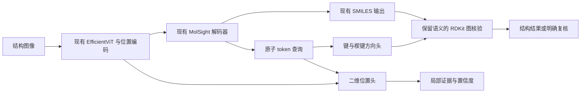

# MolSight 通用化微调设计：小分子、多肽与环肽

日期：2026-11-10。本文区分当前事实、文献依据和待验证设计。设计不代表能力已经提升。

## 1. 决策与边界

本轮范围按用户最新要求收敛为**完整分子、小分子、多肽和环肽**。Markush 与 fragment/attachment 暂不训练、不作为本轮优化指标。历史混合数据与历史结果保留作审计，不代表当前采样范围。

继续在现有 MolSight 检查点上微调，保留 EfficientViT 编码器、12 层解码器、现有词表和 SMILES 输出。不使用 SELFIES，不从头训练基础模型，也不将多肽强制压缩成氨基酸序列。

核心方向是**分子图约束的多粒度微调**：使用同一个模型学习原子、键、绘图位置与完整结构，最终用保留立体化学的图等价性验收。SMILES 是交换和生成表示，不是化学等价判据。改成 RDKit 比较本身并不能修复模型没有读懂图片的问题；现有奖励本来已经使用图比较。

近期优先级：

1. 修复数据监督粒度和真实来源覆盖；
2. 在保留全部旧权重的条件下启用原有边/坐标任务；
3. 增加高分辨率与大型环肽有效训练曝光，同时保留小分子能力；
4. 候选质量达到可学习水平后，再开展受控强化学习；
5. 用独立来源的整图精确识别及真实服务验证决定是否上线。

不是承诺更换一种表示或奖励函数即可解决所有情形。不可辨认或本身含歧义的图，产品应保留未知语义或请求复核，不能由化学先验补造确定结构。

## 2. 当前证据

### 最新实验状态（2026-11-10，本次现场核验）

- 当前实验：`/home/dahuilangda/molsight_work/molsight_graph_joint_focus_v2`。配置显式排除 `markush`、`attachment`；主训练采样 complete 40%、peptide 60%，两域分别做保留能力回放，大型专利风格环肽分层加权。
- 在既有 MolSight 权重上联合字符与化学键监督，已完成 125 次真实参数更新，日志中的 loss 和梯度范数均有限；首次自由生成验证进行中，尚无本轮能力改善结论。坐标监督尚未启用。
- 本轮验证 331 张图的原始来源均为 complete/peptide。初始完整分子为 90/128，多肽为 57/192；另外 11 张从 complete 中发现的多肽单列，不与 192 张重复计数。
- MolNexTR 同图对照已完成：仅进程内放宽解码预算为 2048、原子预算为 512，原始权重不变；完整分子 74/128，多肽 51/192（原生预算为 46/192），大型专利风格环肽仍为 0/63，其中 56/63 可解析。长度限制不能解释全部拓扑识别问题。与初始 MolSight 的多肽配对差异区间跨零，不能声称显著优势。两模型保持各自图像预处理，属于同图比较，并非等预处理或等硬件延迟比较。详见 `output/molsight_training_audit/molnextr_extended_vs_molsight_core_same331.json`。
- 合成多肽训练图 9,684/9,684 均找到原始绘图坐标，涵盖全部 3,418 张大型专利风格环肽；图像哈希、坐标数量/边界、绘图分子规范 SMILES 与当前训练记录匹配。此为来源可用性核查，尚未通过独立图像变换/原子映射复核，不等于坐标监督已启用。详见 `output/molsight_training_audit/peptide_coordinate_provenance_train.json`。
- 最终验收使用 RDKit 保留立体化学的完整结构等价；字符 loss、teacher-forced token accuracy 和可解析率仅作诊断。当前图辅助头仍依赖 teacher-forced 原子查询，必须通过自由生成结果检验实际贡献。

### 历史 GRPO 诊断（已停止，以下不是当前图监督训练配置）

权威路径：`/home/dahuilangda/molsight_work/molsight_grpo_patent_large_v1/run`。

| 项目 | 已核实状态 | 意义 |
| --- | --- | --- |
| 架构 | EfficientViT；12 层、512 隐藏维度解码器；QK norm、SwiGLU、RMSNorm | 已有可继续利用的基础，不宜先重训一个更大模型 |
| 当前训练任务 | `formats=['char']`，`regression=False` | `model.py` 仅在 formats 包含 edges/coords 时创建对应头；当前没有这些任务的实际监督 |
| 数据加载 | `PreparedDataset` 返回 image、label、smiles、idx | 当前已导出的 Arrow 只有字符监督；不能因 loss 代码存在就声称多粒度学习生效 |
| 训练数据 | complete 320,577；Markush 357,866；attachment 6,643；peptide 9,684 | 记录数不是独立化学实体数；多渲染图不能冒充新分子 |
| 大型专利风格环肽训练图 | 3,418：512 为 574，768 为 2,766，1024 为 78 | 这些是合成绘图，不能等同于真实专利图覆盖 |
| 第 125 步大型环肽验证 | 0/63 精确；21 个无法解析；可解析对中 41 个原子数不同 | 不只是字符串格式或立体问题，存在明显漏读、重复读和拓扑错误 |
| 当前奖励 | 0.4×RDK 指纹相似度＋0.6×完整图等价 | 非字符串 exact；解析失败时两项均为零 |
| 已观察的大型环肽采样 | 第 9、157、175、190、210 次更新零奖励比例约 92%–98% | 大部分组缺少相对优势；这是指定困难批次，不代表所有训练数据 |
| 采样 | 原 500 步计划仅 14 次大型专利环肽更新 | 单纯观察训练步数容易高估困难样本有效训练量 |
| 参数 | 第 125 步编码器、解码器有真实变化，模型/优化器张量有限 | 证明更新执行，不能证明泛化改善 |

第 125 步小分子完整结构为 92/128，多肽 58/192；基线分别为 90/128、57/192。小面板的微小变化不能构成产品结论。发现集环肽仍为 0/7。

来源：`training/molsight_runtime/{fit.py,molsight/model.py,molsight/prepared.py,molsight/reward.py}`；`output/molsight_training_audit/` 中的参数、曝光和学习信号报告。上述 GRPO 已在第 250 步验证后主动提前终止，详见文末停止决策；当前图监督实验状态见本节开头。

## 3. 文献提供什么依据

- **MolSight 原论文**：先字符监督，再通过原子查询增加键和坐标任务，最后做结构奖励优化。可借鉴的是多粒度监督路径，不是把论文 benchmark 成绩外推为本项目环肽能力。[论文](https://arxiv.org/html/2511.17300v1)
- **MolScribe**：将原子、键及其绘图位置联合建模，为图级核验和局部可解释性提供依据。[作者论文](https://people.csail.mit.edu/zli11010/pdfs/molscribe.pdf)
- **MolNexTR**：结合局部视觉与全局关系，并使用多种绘图风格；其任务设计值得比较，但其模型替换不是本轮微调的前提。[论文](https://arxiv.org/html/2403.03691v2)
- **MolGrapher**：显式候选图及视觉图推理是另一条参考路线；本文不直接替换整个现有模型。[ICCV 论文](https://openaccess.thecvf.com/content/ICCV2023/papers/Morin_MolGrapher_Graph-based_Visual_Recognition_of_Chemical_Structures_ICCV_2023_paper.pdf)
- **MolRecBench-Wild**：提醒传统专利 benchmark 无法充分代表近期真实文献的复杂语义和视觉干扰；采用困难分层评测，而非直接宣称现有指标可泛化。[论文](https://arxiv.org/html/2605.05832v1)
- **Dr. GRPO / DAPO**：分别讨论长度/组内标准差归一化，以及零优势组的采样效率。它们的实验任务不是本项目分子识别，必须另做消融，不能因算法名字较新就直接替换。[Dr. GRPO](https://arxiv.org/html/2503.20783v2)、[DAPO](https://arxiv.org/html/2503.14476v2)
- **RDKit 官方文档**：提供图、立体化学、指纹等工具语义。指纹相似不是图同构证明。[Book](https://www.rdkit.org/docs/RDKit_Book.html)、[Python 文档](https://www.rdkit.org/docs/GettingStartedInPython.html)

后续章节是基于本项目约束提出的设计，不是任何一篇论文已证明的现成方案。

## 4. 表示：一个化学图，附带绘图证据

建议每个样本保存三个相互绑定的对象：

- **化学图 Gchem**：原子元素、同位素、形式电荷、键型、芳香性、立体化学、组成片段；含重复单元、变量、连接点时保留语义 sidecar，不能只剩裸 RDKit 分子。
- **绘图图 Gvis**：对应像素中的原子/缩写位置、键段、实楔/虚楔及方向、标签包围框、可见性与歧义标志。绘图坐标不是三维构象。
- **对齐 A**：source atom id ↔ chemical atom id ↔ SMILES atom-token span ↔ rendered atom id ↔ pixel coordinates。

小分子、多肽、环肽共用 Gchem；肽残基识别、HELM/BILN 及闭环类型是可选派生信息，不是主输出，也不是正确性的替代判据。非天然单体、β/γ 氨基酸、酯键及多种交联均应由原子和键表示。

普通化合物的全图 identity 保留立体、同位素、电荷和组分。不同 SMILES 排列或环编号不应被判错。未指定立体与明确指定立体不能默认等价。盐、互变异构、质子化、去保护等不应在主指标里被静默归一成同一分子。

缩写可有“原图字面身份”和“经可靠定义展开后的化学身份”两套指标。上下文未定义的缩写、R-group、重复区间等保留不确定性；RDKit 比较时不能先把所有 dummy 和标注删掉。

## 5. 数据：先让每个局部错误可被监督

### 5.1 三种监督等级

| 等级 | 可验证内容 | 可参与的任务 |
| --- | --- | --- |
| D1 | 图像和完整结构标签可信，但无绘图位置 | 字符 loss；在 atom-token 映射验证后可用化学键监督；不可虚构坐标 |
| D2 | 合成渲染的原子索引、坐标、键方向和所有几何变换可追踪 | 字符、边、位置和立体视觉监督 |
| D3 | 真实文献/专利裁剪与页码、图号、结构由来源证据复核 | 同 D1；只有实际标注的位置才可用于 D2 类任务 |

现有合成流水线已有图、坐标、SVG 等部分材料，但当前 Arrow 没导出其对齐关系。这是可以从本项目现有资产补齐的关键工程，不等于已经完成。

最低数据 schema 需要：`record_key/component/source/publication/image_sha256/target_graph_sha256/atom_ids/atom_token_spans/edge_index/edge_types/xy/xy_mask/stereo_mask/transform_chain/annotation_version`。语义字段另行记录。每个监督项的缺失状态必须显式表示。

### 5.2 对齐必须先验证

1. 渲染前为原子分配稳定 source id，canonical SMILES 重排后显式记录映射；不能直接按 RDKit 当前 atom index 和 tokenizer 返回列表 zip。
2. 验证 atom-token 数量与属性、双向映射、所有带标签的键和芳香性。
3. 裁剪、旋转、缩放、padding 的变换应用于坐标和楔键几何；随机 SMILES 仅在重新构造映射并通过等价检查后使用。
4. 所有增强后重新验证完整立体身份；图像镜像不能沿用原标签，必须显式处理立体变化，否则禁用。
5. 映射无误的合成小分子、对称环、带同位素/电荷结构、不同闭环和长环肽都要有可视叠图抽检。
6. 只在监督完整可信的样本上给相关 loss；未知标签不是 negative，也不是零坐标。

### 5.3 覆盖、真实性与难例

化学维度按重原子数、可见原子数、环大小、闭环数、立体中心数量、修饰类型、文本缩写和连接类型分层。肽覆盖线性、首尾环、二硫键、内酰胺、硫醚、depsipeptide、多环、分支、N-甲基、D/非天然/β/γ 单体。仅扩大天然氨基酸排列覆盖不够。

视觉维度独立变化：布局引擎、字体、键长、楔键样式、低清扫描、图号/周边文字、相邻结构和裁剪。真实长环肽应有专门的来源复核集合。现有只有少量同一专利的 reviewed gold，不能当成广泛独立测试。

每种实体有多种合法布局及绘图工具；不把某个引擎的固定模板学成“环肽”。退化强度以可读性为界，楔线已经消失的样本不应被要求恢复图中不存在的立体信息。

建立图级 hard negatives：漏一个残基、重复一个残基、错误闭环端点、漏一个 N-甲基、一个手性反转、芳环取代位置错误。它们用于验证 reward/判别器能否识别关键错误，并用于有标注的局部监督或排序；不能把负例当成图像的正标签。

### 5.4 划分与采样

按像素、结构族、publication/patent family、肽组成及派生渲染的关联成分分组。先划分化学实体和来源，再生成其绘图变体。声明未知历史预训练关系；不能只看图片路径不同。

采样同时记录 domain、stratum、resolution、有效图像数、独立实体数及 GPU 时间。困难样本不能永远因零奖励被过滤；应回流监督池。小分子训练不是只靠一个冻结参考约束，必须保留真实正标签监督和独立验收。

## 6. 架构：最大限度复用，逐级增加图约束

### 6.1 首选：现有多粒度路径真正生效

阶段一不换 encoder/decoder：在旧检查点上增加或恢复 `edges/coords` 头，迁移时对所有旧参数严格完整加载，只允许明确列出的新头初始化；输出词表和 token ID 不变。新头学习率可高于已有 decoder，encoder 用更小学习率。数值只是候选搜索范围，必须通过真实梯度和验证选定，不能沿用一个数值到所有阶段。

优先让 char+edge 路径生效，再增加经对齐验证的 coords，避免同时引入多种未知。原子查询来自已有 decoder，不额外把坐标串插入 SMILES 来拉长生成序列。

**限制**：teacher-forced 原子查询带来的低 edge loss 不等于推理时可恢复漏掉的原子。必须在自由生成的查询上评测原子召回、键召回和最终结构；错误 SMILES 仍可能让推理失败。不能声称“打开 graph head 就解决所有无效输出”。

### 6.2 高分辨率视觉微调

继续利用已验证的 Fourier 位置编码扩展，不以“能跑 1024”代替准确率证明。以可见键长、文字高度、楔线保真度和内存预算选择 512/768/1024，而不是所有图强制放大。保持 512 小分子回放，分别报告各分辨率表现。

如长环肽仍局部漏读，再验证“全图低分辨率＋少量局部高分辨率特征”的轻量融合。复用同一 encoder，保留全图坐标；不独立解码每个 tile 后拼接 SMILES，避免切断环和跨片区键。tile 重叠原子的合并需要监督与评测。

### 6.3 可选后续：图像侧原子候选小头

若证据表明主要瓶颈仍是 decoder 漏读/重复读，可在现有视觉特征上增加小型原子位置/属性头，让局部监督不依赖生成的 SMILES 能否解析。与现有 decoder 查询交叉核验，并研究受限图组装。

这属于增量架构实验，不是从零替换模型。需要区分隐式碳拐点、缩写标签和展开后的虚拟原子；不能对图像中不存在的位置作强监督。只有在小分子、长环肽和资源指标都通过对照后再保留。

不优先采用多个互不兼容的独立识别器或强制残基词表；但一个共享模型仍可有多个监督头。也不假定更大的 VLM 自然解决细小楔键和精确拓扑问题。

## 7. Loss：让局部图错误在 RL 前就能学习

推荐逐项启用的总目标：

`L = Lchar + λedge·Ledge + λxy·Lxy + λstereo·Lstereo + λret·Lret`

- **Lchar**：保留当前 smoothed KL/NLL 生成训练，维持既有知识与输出兼容性。不是用字符串 exact 作为正确性指标。保留 token NLL/teacher-forced accuracy 诊断，但它们不替代自由生成整图指标。
- **Ledge**：原子对的化学键监督。普通键保持双向一致；实楔/虚楔保留端点方向，交换端点不能直接套普通对称约束。所有真实正键都必须保留；negative 候选或采样不能遗漏关键闭环。对长分子的 none 类分别归一/采样，防止 O(N²) 无键对掩盖 O(N) 真键。
- **Lxy**：只对经过验证的可见原子坐标作 masked likelihood。现有截断 Laplace 混合实现可复用，先做 NLL、校准与梯度验证，不重复发明另一套定位 loss。
- **Lstereo**：优先纳入楔键/双键方向监督；若需要独立立体 loss，再做消融。最终立体身份必须结合完整图和几何验证，不能将 SMILES 的 `@/@@` 或局部 R/S 字符直接当成旋转/重排不变的图像类别。
- **Lret**：小分子真实标签回放＋冻结参考分布约束。参考独立且冻结；encoder 可训练时不共享会截断梯度的缓存特征。

RDKit 的离散解析和图同构不可直接对 logits 反向传播。图监督通过对齐后的可微 CE/NLL 训练；完整图结果用于验证、候选排序及 RL。这两者不能混为“RDKit loss 已经直接可微”。

按任务的有效原子/边/坐标计数归一化，并正确跨 rank 和 accumulation 聚合；缺失监督给可微零贡献。新增任务从较低权重 warmup，记录各头和共享主干的梯度范数、更新比例与梯度夹角；必要时再测试梯度冲突处理，而非只按 loss 数值大小自动配平。严重错误标签产生的梯度冲突应先处理数据。

原子数量、环大小或闭环数可作轻量辅助任务/诊断，但数量正确不等于图正确。没有明确消融收益时不继续堆 loss。

## 8. 超过 92% 零奖励：如何实质解决

必须同时关注 `parse rate`、真实 EOS、完整图正确率、组内奖励标准差、非恒定奖励组比例与每 GPU 小时的有效更新，而不是只降低零奖励比例。

先对失败作互斥诊断：未终止、SMILES 无法解析、可解析但拓扑错、拓扑对但立体错、完整图对。额外记录符号标注错误。未终止与后续类别可同时保留原始 flags，但汇总时优先级要固定。

### 8.1 基础候选不够好：用密集监督提升

当同一困难图片的多个候选大多不可解析，继续加大 GRPO 采样量通常很贵。先用 char+edge(+verified coords) 提升结构读取能力，并对零优势困难图片保留监督曝光。监督梯度不依赖模型当前采样能否碰到正确答案。

当前已经安排的集中环肽 SFT 是**曝光和 encoder 适配对照**，仍为 char-only，不能把它冒充本文的图监督方案。它可帮助分离“训练曝光不足”与“缺少结构监督”两个问题。

### 8.1a 单独识别采样导致的稀疏性

当前温度为 0.7。长 SMILES 逐字符随机采样可能将可用的贪心预测变成难解析候选，但现有 greedy 验证和训练 rollout 来自不同图，不能据此直接认定温度是原因。

优先固定同一批开发图和同一检查点，对 greedy、温度 0.2/0.4/0.7 的采样作对照；相同候选数、完整长度预算、精度、图像预处理和 EOS 统计。分别记录有效图比例、distinct graph 数、完整图匹配率、非恒定奖励组比例和采样成本。低温虽然提高有效率，若候选全变成同一个错误图，仍然没有优势信号；需要在有效性和结构差异之间选择，而非最大化某一个指标。

若低温能恢复有差异的有效候选，先测试采样策略这一低改动修复，再评价额外结构监督的收益。若同图 greedy 本身也读错骨架，不能靠调温度解决，继续走局部监督路径。任何温度或约束改变均需让 rollout、old/current log-prob 和 reference 概率在同一分布下计算，作为新实验记录。

### 8.2 可解析候选：使用可靠的图级差异

保持完整带立体/标注的图等价为唯一满分。对不完整但可解析结构，候选 shaping 特征可包括：计数型子结构指纹、可验证对齐下的键 F1、原子/键数量偏差、闭环端点错误、立体一致性。它们是待消融项，不立即将所有项混成未经验证的新奖励。

现有 RDK bit 指纹易把重复局部片段压成相同存在性，针对多肽应专门测试计数敏感性。必须用“重复一个残基”“漏一个残基”“错误闭环但局部片段相同”等负例验证；不能因 Tanimoto 高就认为整条环肽正确。计数指纹仍不是拓扑证明。

不同图的 shaping 奖励应有上界，与 full exact 留出明确间隔；空图、只输出最常见片段、漏长侧链、删除难认官能团不能获得接近满分。所有项同时检查小分子，避免专门奖励肽样骨架。

对于无效 SMILES，不将“猜一个修复结构”所得分当作模型原始图奖励；先通过监督解决。否则模型可能学会输出容易被修复的错误。语法约束解码可以做独立推理/训练实验，但 old/current/reference 必须使用相同约束分布，且仍需验证完整结构正确。

### 8.3 RL 只在产生有效结构差异后做

先固定一个开发 rollout 集，按小分子、短肽、长环肽和图像分辨率测量候选分布。可把“有效解析率约 80% 以上、EOS 接近 99%、多数困难图有非恒定候选奖励”作为**探索性进入条件**，具体阈值要经校准；它们不是产品验收线，也不是已达成事实。

零优势组的有界补采样可提高有效训练比例，但设置上限，并将持续失败图片回流监督训练，保留它们在总体统计的分母中。直接永远丢掉这些组只会令报表更好看。

分别比较现有 GRPO 与去组内 std/固定长度归一的变体；固定初始权重、采样集、温度、token/图像预算和参考策略，记录额外采样成本。正负优势与长度之间的关系必须按分子大小分层。不要把化学上必然更长的环肽当成冗余回答惩罚。

## 9. 受控实验与停止规则

| 实验 | 固定条件 | 主要变化 | 回答的问题 |
| --- | --- | --- | --- |
| A | 已有模型、数据、原 char loss | 记录当前 GRPO 结果 | 已运行策略能带来多少增益 |
| B | 相同初始 SFT checkpoint | 困难环肽曝光＋高分辨率适配＋小分子回放 | 数据/曝光本身能否解决主要瓶颈；不是 RL 算法等预算消融 |
| C1 | B 的数据和预算，旧主干权重 | 增加验证过的化学边监督 | 局部图监督是否有额外收益 |
| C2 | C1 设置 | 增加绘图位置监督 | 位置约束是否减少漏读/重复读 |
| D | 已验证的 C 模型 | 更适合大图的 shaping 或 RL 归一化，分别测试 | 在候选有效后是否还能提升 exact |
| E | C/D 的已选模型 | 可选高分辨率局部融合/小型图像原子头，逐个实验 | 现有主干视觉或 token 查询是否成为剩余瓶颈 |

所有实验从明确检查点建立新 run，保存旧权重覆盖、新参数初始化、数据 hash、采样、head 配置和 optimizer 分组。不能把新增头或新奖励静默塞进旧运行并继续宣称同一实验。报告图像曝光和 GPU 时间，不能只用 update 数“等预算”。

数值非有限、权重缺失、词表错位、跨 split 泄漏、坐标错配立即停止对应实验。验证发现小分子显著退化、环肽增益只来自修复或删除困难样本时不发布。若在固定预算和足够数据覆盖下仍无图级收益，先诊断监督/视觉，不继续盲目延长训练。

## 10. 训练、参数与产品验收

- 小 batch 保持 encoder normalization 统计稳定；BF16 前向配 FP32 归约，逐任务梯度有限；clip 之前/之后的范数含义明确。
- DDP 与单卡同一全局 batch 的损失/梯度对比覆盖新增任务、缺失标签和不等长样本；有效计数不是每个 rank 简单均值。
- 保存与恢复模型、optimizer、scheduler、scaler、各 rank RNG、采样位置和任务权重；连续训练与断点恢复在同一更新边界比较参数及自由生成结果。
- 检查新头参数有梯度、有实际变化；冻结参考参数无变化。严格加载并验证全部 tensor、词表、head/grid 配置，不能用 `strict=False` 掩盖错配。
- 训练/评测/服务用相同图像预处理、位置编码、SMILES 解码和语义比较。原始预测、修复预测分开；不完整或不可解析结果明确失败。

评测必须分三类：开发验证集用于选配置；最终冻结适配测试集用于一次性比较；新来源、人工复核的真实图用于外部泛化验收。现有 882 成分组面板中有 1 个已用于工程 smoke，因此报告全 882 与其余 881，并保留曝光登记，不再称全体预测未查看。

主指标：小分子与各类肽的全图精确匹配（包含立体和特殊语义）；配对 gains/losses 和置信区间；按来源、大小、闭环类型、修饰、分辨率和降质分层。结构、原子数、边、立体及 EOS 指标用于解释主指标，不能替代它。

真实图验收需扩展到多个未参与微调的 publication/patent family，由原图与结构证据绑定；样本量应按期望差异和配对错误率做功效分析，而不是认为固定几十张足够。MolRecBench-Wild 可作为外部挑战集候选，接入前检查许可、标注语义和历史重叠，不用其测试结果反复调参。

上线还要满足真实服务的正确加载、端到端裁剪、延迟、吞吐、显存、取消/异常和置信度复核流程。最终要交付可重载的最佳模型及证据，而不是训练结束日志。

## 11. 接下来最有价值的实施工作

1. 完成本轮 GRPO 的既定验证并决定其后续；保持已安排 char-only 专项 SFT 的身份清晰。
2. 从已有合成图和 catalog 构建有 provenance 的原子—token—键映射；位置只从实际绘图证据导出。先在小型覆盖集完成完整映射、可视化和立体回环验证。
3. 新建多任务数据版本和显式 head 初始化迁移；先 char+edge，再添加 coords。先验证真实模型的前向、梯度、DDP、恢复和低预算能力对照。
4. 结构性错误明显下降后，再比较 RL 的有效候选比例与最终 exact，而非单独优化零奖励占比。
5. 保留线上 R3、初始 SFT、当前 GRPO、专项 SFT 和多粒度候选的清晰比较链。没有独立小分子与环肽收益证据前，不切换线上模型。

本设计没有改变当前运行进程，也没有将待实施的多任务训练描述为已完成。根本方向是让现有模型从可信的局部化学证据中学习，再以完整分子图结果闭环。

### 现场执行更新：12:05

第 250 步 GRPO 评测完成：complete 89/128（初始 90），peptide 55/192（初始 57），大型环肽仍 0/63，整体配对变化区间跨零。以缺少目标域收益和困难 rollout 信号稀疏为由，保留 checkpoint250 后主动提前终止；不是数值崩溃，也不是宣布统计显著退化。原 500 步计划保留不改，停止决策单独留档。

原监督串行任务的等待条件被明确替换，已确认 GRPO workers 全部退出后启动原先准备的 char-only 专项监督对照，主进程 PID 2893956，workers 2893966/2893967。该任务不是图监督训练；其启动基线、首批更新、梯度和后续识别收益仍需现场核验。图监督迁移单独推进，不改动它的运行源码。

### 独立调研与现场执行更新：14:10（四路独立调研 + 两项新实证）

四个独立调研（代码栈 / 失败模式 / MolNexTR 外部文献与本地代码 / 坐标数据链）交叉完成，全部只读，未改动运行中实验。以下区分实证事实与推断。

**实证 1：char+edge 训练轨迹（`molsight_graph_joint_focus_v2/run/validation_000{125,250,375}.json` 与 `baseline.json`）**

| head_to_tail_patent_large (n=63) | 初始 | 125 步 | 250 步 | 375 步 |
| --- | --- | --- | --- | --- |
| 精确匹配 | 0/63 | 0/63 | **1/63** | 1/63 |
| 可解析 | 40 | 37 | 36 | 37 |
| 预测-标签字符长度偏差中位 | -36 | -1 | -2 | （原子数偏差中位 **0**） |

complete 域全程未回退（exact 0.703→0.719→0.711）。250 步首次精确命中的记录为 `07fcfdbbb547ddd2…`（768px）。**375 步可解析输出的原子数偏差中位数已为 0**：错误性质正从"漏读/重复读原子"转向"原子数正确但排列/立体错"。这是趋势证据，1/63 不构成能力结论；最终判定等 500 步评测与冻结测试。

**实证 2：坐标监督数据阻塞解除（新审计 `output/molsight_training_audit/audit_atom_perm.py` → `peptide_atom_perm_train.{json,jsonl}`）**

- 9,684/9,684 训练肽记录完成 `drawing.mol 原子序 → canonical SMILES 原子序` 排列导出，并逐原子以原子序/总 H/形式电荷/同位素验证通过（含全部 3,418 张大型环肽）；sidecar atom_indices 数量全部一致。
- 其中 **9,666 条排列非恒等**（仅 18 条恒等）：此前"直接按原子序 zip 坐标"会造成系统性坐标错位且训练不报错，该陷阱现已用显式 perm 排除。
- 独立像素抽验：48 张分层抽样，±2px 窗口墨迹命中率均值 92.1%（最低 78.5%）。与渲染期仿射审计（残差<1e-4）共同支持坐标可信；更低命中率样本归因（标签锚点 vs 字形中心）留给叠图抽检（P2）。

**实证 3：MolNexTR node/edge 中间量探针（`/home/dahuilangda/molsight_work/molnextr_probe_atoms63_v1/`，同 63 图、扩展预算 2048/512、原始权重不变）**

- node 阶段（逐原子 AR 输出 symbol+x+y）解码原子数对 gold 重原子数偏差：中位 **-78**、均值 -95.8，仅 2/63 在 ±10 内；55/63 输出碎裂为多片段（≥5 个 dot），7 个空分子。atom budget guard 无触发，bond guard 仅 4 例——**失败发生在序列发射阶段，而非边组装预算**，与 MolSight 的 AR 漂移同类。
- 与 MolSight 逐图原子数偏差相关 r=0.347（n=35），且**没有任何一张图两模型同时接近正确**（±10 内 0 张）。两家失败彼此独立，融合/互检空间存在，但"换成 MolNexTR 表示"本身不解决大环肽。
- MolNexTR 训练分布（PubChem 1M + USPTO 680K）几乎不含 100+ 重原子头尾环化分子，是其 0/63 的第一因；本地已确认其 `predict_images(return_atoms_bonds=True)` 接口可用。

**失败模式分类（互斥，初始检查点 / joint 125 步，RDKit 复判）**：可解析但原子数不等 39→36（偏少 23→19、偏多 16→17）；原子数相等但拓扑/立体错 1→1；不可解析 17→24（其中宏环闭合数字 `1` 未输出 15 例）；未终止 6→2。残基级对齐（125 步）：gold 1,102 段正确复现 907（recall 82.3%），多插 243 段、漏 195 段——**视觉读取大体成立，瓶颈在自回归组装**。解码预算排除（gold 最长 847 字符 vs max_len 2048，仅 2/63 触顶）。数据无泄漏（composition_group train∩validation=0），验证 63 张为合成渲染开发面板，非真实专利裁剪、非盲测。

**推断与下一步（均未执行，不构成能力结论）**

1. **坐标监督（设计 C2）具备启动条件**：模型头/截断 Laplace loss/推理分支代码现成；数据侧缺口已收敛为 P1 工程——perm+坐标写进 sidecar（`molsight_multitask/export_graphs.py`、`molsight_data/graph_supervision.py` 替换 `coordinate_targets: None`）、`GraphDataset/collate_graphs` 加 coords、`create_student` 护栏放行 `decoder.loc_predictor.*`、`validate_configuration` 精确字段集、GraphCriterion 独立 coords 分支（retention replay 的 `collate_characters` 无 coords，不能并入 Criterion.formats）、benchmark head 契约放行。完成 P2 叠图抽检（分层 ~200 张，重点 patent_large 768/1024）后再开训练。
2. **解码侧诊断（不碰权重）**：GPU 空闲后在初始与最终检查点上跑 63 图对照——重复抑制（`molsight/inference/decoding.py:162` 现有 TODO）与环闭合数字一致性约束；并按 8.1a 做 greedy/温度对照评估 RL 候选有效性。这些是诊断，不是上线手段。
3. **环闭合 token 加权**（16→24 例不可解析的主伤是宏环 `1` 未闭合）：下一训练阶段的低改动候选，须消融验证。
4. **MolNexTR 同语料微调**（独立路线/分布假设检验）：渲染管线逐原子坐标与其 node 格式（symbol+x+y, 100 bins）天然对齐，数据转换可从 `drawing.mol`+`atom_positions`+perm 派生；作为对照实验待 GPU 预算确认后启动，不影响 MolSight 主线。
5. 停止规则不变：数值非有限、权重缺失、词表错位、跨 split 泄漏、坐标错配立即停止；小分子显著退化或环肽增益仅来自删样本不发布。

### 后续现场更新：14:55（500 步终评与 node/edge 假设检验设计）

**graph_joint_focus_v2 已完成 500/500 步**（状态 `training_finished_requires_capability_evaluation`，GPU 已释放）。终评 `validation_000500.json`：head_to_tail_patent_large 维持 **1/63** exact（36 可解析中环数全对仅 5、原子数 ±2 内仅 3）；complete 0.719（基线 0.703，未回退）；peptide 0.302（基线 0.297）。**结论：char+edge 监督 500 步未突破大环肽壁垒，暴露"序列组装"这一结构性瓶颈；下一阶段需要结构性改动，不是继续堆同质监督。**

**MolNexTR 探针追加分析（同 63 图，`molnextr_probe_atoms63_v1/`）**：解码原子空间定位精度 45.5%（±1.5% 图幅内落在 gold 原子上；质心偏移校正后 47%，排除帧错位），gold 原子覆盖率中位 23.6%；解码图环亏缺（cycle rank − gold 环数）中位 **+68**——边分类在少量原子上过度连边成大量伪小环，而不是"环闭合缺失"。**发现关键混杂：MolNexTR 固定 384×384 输入（model.py `get_transforms(384,384)`），我们 512–1024px 稠密大环肽被硬缩到键长 ~6–9px**。其 node 发射崩坏（中位 -78 原子）是"分布外 + 分辨率不足"的联合结果，不能据此否定 node+edge 表示路线本身。

**"node+edge 是否是关键"的检验框架**（回应结论：SMILES 自回归对大环肽的结构性弱点已被证实——宏环闭合数字跨 ~700 token 的长程依赖正是主要失败点，15/24 不可解析是宏环 `1` 未闭合、环数全对仅 5/36。但"换成 node+edge"必须同时补分布与分辨率，三者缺一不可）：

- **E2（进行中，零训练）**：`molsight_edge_probe_v1/edge_probe.py` 在 update_000500 上测——① teacher-forced gold 序列的 edge-head bond F1（头质量上界）；② 自由解码序列上 edge-head 与其自产 SMILES 键的自一致性（extra/missing、长程 extra、环数）；③ 用解码原子 + edge-head 键重组分子重评分。若 ③ 优于 SMILES 发射或 ② 显示 edge head "知道"未闭合的宏环键，则在 MolSight 自身证实 node+edge 内部知识存在、SMILES 发射浪费了它。
- **E1（下一步）**：MolNexTR 在我们的环肽语料上微调（数据从 drawing.mol + atom_positions + perm 派生，其 node 格式 symbol+x+y 原生消费逐原子坐标；本地克隆无训练入口需自建）。控制 384px 分辨率混杂：如 node 发射仍崩坏，加渲一档键长适配 384 的渲染变体。这是"node+edge + 正确分布"的直接检验。
- **E3（并行推进）**：MolSight 坐标监督 P1 工程（perm 审计已解除阻塞）+ 环闭合 token 加权消融。

### 后续现场更新：16:30（edge head 三重否定结果与先进基座验证）

**发现 1（实锤）：`molsight_graph_joint_focus_v2` 训出的 chemical edge head 已退化为"全无键"预测器。** 用训练同款 loss 代码（`molsight_multitask/edges.py`）在 gold teacher-forced 序列上复核：argmax 直方图 [267,415, 0,0,0,0,0,0]——全部原子对预测 none，含全部 1,852 个真实键对；正类平均概率 0.174 ≈ 均匀 0.143。同图自由解码探针（`molsight_edge_probe_v1/edge_probe.jsonl`，63 张）TF bond F1 全为 0.0，用 edge head 键重组分子 0 例成功。训练日志 chemical_edges 0.003→0.099 的"下降"实为 `edge_weight` warmup 乘子回归，raw per-image loss ≈ 0.99 ≈ 0.5×1.93(正类≈ln7)+0.5×0.05，**正类从未学到**。根因分析（待消融确认）：`edge_weight=0.1` 在保护主干的同时把 head 自身梯度也缩了 10×（head 仅从 edge loss 获得梯度）；O(N²) 负类主导下 500 步内塌缩到多数类；MolNexTR 同类头可用是 10:1 类权重 × 40 epochs × batch 256 的曝光量级。

**发现 2（基座否定）：decoder token hidden states 不是 pairwise 键预测的可训练基座。** 对照实验（`molsight_edge_head_retrain_v1/`）：① 全冻结仅重训 head（缓存 hidden、不缩水梯度、positive_weight 0.8、lr 2.5e-4、3,000 updates = 12k 图曝光）：训练缓存上 loss 0.82→0.5 有拟合，patent_large 验证 endpoint F1 仅 0.021（预测键中位 29k vs gold 312，"过度连键+不泛化"）；② **单图过拟合对照**（lr 1e-3、3,000 updates，只为背下自己训练的那一张 292 原子图）：endpoint F1 = **0.056**。连记忆单图都做不到 → 原子查询 hidden 态对相距数百 token 的键端点无互相可辨识信息，concat-MLP pairwise 头对此基座不可训练。

**发现 3（先进基座验证通过）：同协议下 SpatialAtomGraph 完美记忆单图。** 新模块（`molsight_spatial_graph_v1/spatial_atom_graph.py`）：冻结 MolSight update_000500 的 EfficientViT 特征图 → 原子 query 以金坐标锚定 → 4 层 graph transformer（原子间全对 self-attention + deformable cross-attention 以 grid_sample 在 learned offsets 采样特征，分辨率保持）→ **biaffine 低秩 pairwise 打分**（依存句法标准做法）+ 元素分类头。同一协议（同一张 292 原子 patent_large 训练图、lr 1e-3、3,000 updates、同 merged loss + positive_weight 0.8）：endpoint F1 = **1.0**（306/306 键，零多余），元素 acc 1.0，loss→0；学习曲线 250 步 0.64 → 750 步 1.0。MLP 0.056 vs 本基座 1.0 —— 基座成立，与用户"不要 toy、特别是 MLP"的约束一致。

**进行中：Stage 2 泛化门**（`molsight_spatial_graph_v1/stage2_generalize.py`，GPU1）：~1,400 训练图（patent_large 900 + 其他肽 500，均 perm 验证过的坐标）预计算特征后训练，评测 30 张 held-out patent_large 训练图与 63 张验证图的 endpoint/typed F1 与整图全对数。通过标准：held-out F1 显著高于随机。通过后依次推进：Stage 3 图→RDKit 组装→与 AR SMILES 在 63 图对比；Stage 4 检测化（query 池 + Hungarian 匹配 + 原子计数头，去除 teacher 坐标）；与 AR 输出交叉核验的路由策略。数据侧无阻塞：坐标/perm 已验证（`peptide_atom_perm_train.jsonl`），训练路径零几何增广。

**对表示路线的总结论（今日证据链）**：SMILES 自回归的宏环长程依赖失败（15/24 不可解析=宏环 `1` 未输出）+ decoder-token MLP 头不可训练（0.056）⇒ 大环肽的结构性出路在**空间锚定的图基座**：node（原子元素+坐标）+ edge（biaffine 键）从 encoder 空间特征直接读取，图组装走 RDKit。MolSight 的 AR SMILES 路径保留为小分子主路径与大分子交叉核验源。

### 后续现场更新：17:40（三路独立 code review 的修正——结论边界重划）

按用户要求对 `molsight_spatial_graph_v1/` 做了三路独立评审（架构 / 训练过程 / 红队）。修正如下，先于任何新数字：

**P0（已实锤）**：`stage2_generalize.py` 在 update 1 崩溃（缓存特征带 batch 维 → 5D conv 输入），**泛化数字此前为零**；"正在运行"的说法不成立，已由两个评审独立核实。

**红队核心发现（重划对照线）**：一个**零学习、不看图像**的几何规则基线（gold 坐标 + 最近邻距离中位数×1.05 阈值 + RDKit 价态贪心）在 63 张验证图上 bond endpoint F1 中位 **0.973**（memorize 那张图 0.982）。根因：`cyclopeptide2d` 布局器保证等键长（min/max_bond_ratio≈1.0、非键间距≥0.86×键长）——**几何捷径在这套合成语料上近乎免费**。因此：
- "memorize F1=1.0 vs MLP 0.056 → 基座先进"的表述**不成立**：对照存在四重混淆（输入模态/坐标锚定/架构/不同图），且相对规则基线的边际只有 +0.018
- 红队前向探针（有利证据）：memorized 模块在零特征/噪声特征/常数图/空间重排下全部崩到 F1=0，特征×0.5 → 0.24——它**确实在用图像**，但"用多少值多少"须由重训消融回答
- typed F1 旧定义饱和（全 none 预测器 0.993），已改为带标签键集合上的真 F1
- 正确的门线：**图像变体须显著超过 0.973 规则基线（配对检验），且须超过零特征重训消融**，否则"图像承载化学信息"不能宣称

**其余 P1/P2（按评审修）**：缓存 squeeze（P0 已修）；typed F1 重定义；element 类数只由 train 决定（并显式断言 heldout/val 无超类）；checkpoint 带 config/splits 元数据；训练后自动做三件核验——重载复现、参数增量审计（死参数检测）、打乱坐标 chance 检验。已知未修（记录在案，下一轮处理）：coord_head 死通路（refined 被丢弃）、value_proj 死参数、coord 编码无 sin/cos、biaffine 无 Δ坐标输入、post-norm 稳定性、memorize 与 stage2 元素标签空间不一致。

**Stage 2 v2 协议**（`stage2_v2.py`，GPU1 运行中）：同一缓存上先后训练**图像变体**与**零特征消融变体**（各 2500 updates，~2 分钟/个），同协议评测 heldout 30 + 验证 63，内置规则基线、chance 检验、重载核验、参数审计。**结论边界（预注册）**：图像变体 > 规则基线 且 图像 > 零特征消融 → 才能说"在 teacher 坐标条件下图像读出器在该合成分布内有泛化且用到图像"；距离"解决真实环肽专利问题"还差：检测阶段（无 teacher 坐标）、真实第三方渲染图评测（≥300 张、按专利族分组、含缩写/楔键/遮挡）、端到端组装。合成语料的等键长保证意味着当前一切数字都只是**内插**证据。

### 后续现场更新：18:55（stage3 通过 + 键型分水岭 + 组装验证启动）

**Stage 3 结果**（`stage3_v3.py`，SpatialAtomGraph2 按评审 P1 清单升级 + 30k updates warmup/cosine，全套控制项）：

| 变体 | heldout endpoint F1 | val endpoint F1 | val typed F1 |
| --- | --- | --- | --- |
| **图像变体** | **0.980**（中位），1 张整图全对 | **0.972** | **0.972** |
| 规则基线（零学习） | 0.974 | 0.972 | **0.644** |
| 零特征消融 | 0.663 | 0.667 | 0.652 |
| chance（打乱坐标） | 0.008 | 0.008 | — |

判定（预注册协议）：① endpoint 拓扑与规则基线**打平**（0.972 vs 0.972）——到达合成语料的几何天花板；② **typed 键型是分水岭**：图像模块 0.972 vs 规则基线 0.644 vs 零特征 0.652——单/双/芳键型几何不可推，**这部分化学信息确实由图像读出**，红队要求的"图像超越几何"在键型维度成立；③ chance 0.008 证明使用坐标-原子对齐而非类别先验；④ 重载核验逐位一致；死参数 28→4（coord_head 已激活）。

**边界**（不可超出）：teacher 坐标 + 同渲染引擎内插 + typed 未做立体（楔键方向在当前 7 类契约下不可恢复）。真实专利图上等键长保证不存在，几何天花板会下降，图像边际预期扩大——但这要在真实评测集上证实。

**Stage 4（进行中）**：`assemble_eval.py` 用 stage3 图像变体的预测元素+键型组装 RDKit 分子 → MolSight 同款评测器对 63 张打分，对照 AR SMILES 路线的 1/63。若组装路线 resolved_exact 显著更高，即证明"图路径解决 SMILES 路径解决不了的大环肽问题"（teacher 坐标条件下）。**下一主战场**：检测化（learnable queries + Hungarian + 计数头）去除 teacher 坐标——真实推理形态，也是 0/63 的原始瓶颈所在。

### 后续现场更新：20:40（v4 门正式通过——60k 步 cosine 尾段是关键；错误结构修正；RL 就绪度框架）

**重要更正**：此前"v4 卡在 0.972 同天花板"的判断是**读了中途快照的误判**。完整学习曲线：35k 步 0.856 → 60k 步 **0.996**——cosine 退火尾段贡献了决定性提升。教训入档：中途快照不得作为终局结论。

**v4 正式结果**（`stage4_v4.py`：SpatialAtomGraph2 + 逐图几何校准条件注入，60k updates，seed 41，全套控制项）：

| 变体 | val endpoint F1 | val typed F1 | val 整图全对 | heldout 整图全对 |
| --- | --- | --- | --- | --- |
| **图像变体** | **0.996**（中位 0.9961/均值 0.9955） | **0.996** | **10/63** | 7/30 |
| 规则基线（零学习） | 0.972 | 0.644 | 0/63 | 0/30 |
| 零特征消融 | 0.852 | 0.822 | 0/63 | — |
| chance（打乱坐标） | 0.008 | — | — | — |

预注册门（图像 > 规则基线 且 > 零特征）**两项全过**；重载核验逐位一致；死参数 4。对照 AR SMILES 路线同 63 图整图 exact 仅 1/63。**结论边界不变**：teacher 坐标 + 合成等键长语料内插 + 无立体；这证明的是"读出器基座"成立，不等于端到端解决。

**组装与错误结构（含一次重要更正）**：valence-greedy 组装（键级记账价态贪心）使 63/63 全部可解析（AR 37/63），但 exact 0。错误解剖曾误报"漏键为主"（分母算错）；**修正后的真实结构：漏键仅 7 个（中位 0/图），错误主体是 1,137 个假阳性多键（~18/图）**——负类校准问题。10/63 整图全对出现在 60k 长训后，说明假阳性随训练显著收敛；残余瓶颈按序：检测化 > 立体契约 > 假阳性校准。

**RL 决策框架（回应用户"是否需要强化学习"，数据判定中）**：
1. **AR SMILES 路线**：GRPO 已实证一次失败（零奖励组 0.92-0.98——正确的 ~800 字符组装在当前策略采样下概率≈0，无组内优势信号）。RL 就绪度探针（`molsight_rl_readiness_v1/`，运行中）按设计文档 §8.1a 测 greedy/T=0.2/0.4/0.7 × k=8：判定树——若某温度下 parse rate 显著回升且组内奖励方差出现且 any_exact>0 → RL 有信号，可按 §8.2 shaped reward 重启 GRPO；若候选仍全错/全同 → RL 仍死，继续监督侧。
2. **空间图路线**：当前瓶颈（检测、立体、假阳性校准）全部是监督/解码问题——CE 监督信号稠密且已到 0.996，**RL 不适用也不必要**。

**RL 就绪度探针终局数据（`molsight_rl_readiness_v1/rl_readiness.json`，21:02，修复切片 bug 后）**：greedy parse 0.603、any_exact 1/63；**T=0.2：parse 0.669、85.7% 组有奖励方差、any_exact 1/63、mean_best 0.361；T=0.4：parse 0.671、92.1% 方差、mean_best 0.373；T=0.7：parse 崩塌至 0.032**。判定：
- **信号未死但天花板信号仍稀疏**：相对 GRPO 期 0.92-0.98 零奖励，低温度下 86-92% 组有方差（Tanimoto 分量驱动），GRPO 组优势可计算；但 perfect candidate 仍仅 1/63——RL 能学"0.26→0.37 的提升"，几乎学不到"全对"。
- **重要归因**：原 GRPO 用 T=0.7 采样，而 T=0.7 使 parse 崩到 0.03——当时零奖励 0.95+ 的主因之一是采样温度本身。
- **§8.3 进入条件未满足**（parse 0.67 < 0.8）。
- **结论：RL 现在是"低温度+shaped reward 下条件可重启"，但边际收益不是最大**。最大杠杆仍是图路线（检测/立体/假阳性校准）与"图 verifier 给 AR 候选重排/引导"——后者不用 RL 就能拿到非自回归的直接验证信号。若产品形态定为"大分子走图路线、AR 管小分子"，AR 的 RL 需求进一步下降；若必须 AR 独立达 exact，RL（T=0.2-0.4 + verifier-shaped reward + 零优势组补采样）是最后一段的正确工具。
3. **AR 的 exposure bias**（teacher-forced 99.4% vs 自由解码 0% exact）是 RL 最终要解的问题类别，但前提是 rollout 分布里存在接近正确的候选。**结论形态：RL 在 AR 路线最终大概率需要，但不是现在**；先让监督侧把候选分布抬进"有信号"区间（图验证约束解码/verifier 引导是中间站），RL 探针数据将给出可/不可的实证边界。

### 后续现场更新：21:05（检测化启动 + 立体契约可行性确认 + RL 探针终局）

**Stage 5 检测化（`stage5_detect.py` + `spatial_atom_detector.py`，GPU1 训练中）**：DETR 式 416-query 池（网格初始化锚点）+ 6 层（全对 self-attn + deformable cross-attn + 坐标精修链）+ objectness/坐标/元素头 + biaffine 键矩阵；Hungarian 匹配（类别概率+10×L1 坐标代价）提供监督；键标签经匹配置换到 query 索引。评测完全去除 teacher 坐标：objectness>0.5 选原子 → 同款 valence-greedy 组装 → MolSight 评测器。60k updates（~5.7h）。启动经历 4 个 bug（gold_index 错位/bf16-numpy×2/作用域）全部修复；update 2500 时 atom F1 0.10（从 0.03 爬升）、coord loss 0.39→0.05。

**立体契约可行性（新实证）**：`drawing.mol` 中 BondDir 全 NONE（渲染器从手性标签+2D 坐标自动楔化），但监督链可确定性重建——`Chem.WedgeMolBonds(mol, conformer)` 得到 28 个楔键（正是画面所画）；恢复实验：剥离手性标签 → 按楔键方向重建 → `AssignChiralTypesFromBondDirs` → **28/28 手性中心还原、isomeric SMILES 回环一致**。实现注意：现 chemical_edge_sums 把 [1,5,6] 合并训练，楔键方向需独立监督头（biaffine 二类：i→j 楔/无）或改用 MolNexTR 式 7 类加权 CE；推理端用预测坐标+楔键类别经 AssignChiralTypesFromBondDirs 重建手性。立体监督数据侧零障碍，仅差契约实现。

**RL 探针终局**（数据见上文判定）：T=0.2/0.4 下 86-92% 组有奖励方差（GRPO 机制可算），但 perfect candidate 仅 1/63；T=0.7 崩塌（parse 0.032）——**原 GRPO 失败主因之一就是采样温度**。RL 现状=低温度条件下可重启，但不是当前最大杠杆；图路线与 verifier 引导优先。

### 后续现场更新：2026-11-11 上午（里程碑：图路线带手性整图精确 19/63，AR 路线 1/63）

按用户要求从根源解决后，两个源码级根因分析 agent（RDKit Chirality.cpp/MolFileParser.cpp/MolFileWriter.cpp/Kekulize.cpp/WedgeBonds.cpp 源码 + 逐键 diff 实验）定位并修复了立体恢复链的全部机制障碍：

1. **R4 静默门槛**（Chirality.cpp:555）：手性中心邻键必须全 SINGLE，含 AROMATIC 类型键则整体跳过——解释了芳香态构建的 0 标签。
2. **Sanitize 内部 kekulize 清除 BondDir**（Kekulize.cpp:389-390）：楔键方向必须在 SanitizeMol **之后**设置。顺序错误 = 0/63（实测）。
3. **芳香 N 的 [nH] 丢失**（逐键 diff 实证）：裸原子重建丢 NumExplicitHs/NoImplicit → 吲哚（9 原子）/咪唑（5 原子）正好是失败原子集；`sanitize_with_aromatic_search` 的 `>6` cap 放弃了芳香 N≥7 的样本（最大 14）。修复：无 cap 枚举（2^14 最坏 14.4s，25/25 全修）。
4. **y 轴镜像（最后一击，实测翻转变零）**：恢复链 conformer 使用渲染像素坐标（PIL，y 向下），而 RDKit 楔键语义在 y 向上绘图坐标系——伪 3D 手性判断对镜像敏感，全部手性中心 R↔S 反转。修复：conformer 内 y'=(1−y)。**楔键训练标签（重跑 WedgeMolBonds 在 y-up 坐标系）始终正确——无需重训。**

**stage6d 端到端结果**（预测元素/键/楔键，teacher 坐标，63 张大环肽验证面板，MolSight 同款评测器）：

| 指标 | 图路线 | AR SMILES 路线 |
| --- | --- | --- |
| 可解析 | **60/63** | 37/63 |
| 拓扑全对 | 19/63 | — |
| **带手性 resolved_exact** | **19/63** | **1/63** |

楔键头：F1 0.985、方向准确率 0.9994（联合微调，checkpoint `wedge_joint.pth`）；读出器键 F1 0.9956 无退化。

**结论边界（严格执行）**：teacher 坐标 + 合成等键长语料内插 + 开发面板（非盲测）。

### 权威评估器上线与最终 checkpoint 排序（2026-11-11，canonical_eval.py，锚点自检通过）

三次评估路径 bug（解析后 clearSingleBondDirFlags、pred_set 排除芳香键、缺芳香 N 回退）导致 stage6h focal 联合微调被误判为"崩溃"。权威评估器（canonical_eval.py，evaluate_item 逐行移植 + 锚点自检：wedge_joint 必须精确复现 parsed 60/topo 19/literal 19/resolved 19，不符即拒绝评分其他 checkpoint）已上线，其后所有对比只准通过该模块。**教训入档：评估路径任何变更必须先过金标锚点回归。**

权威排序（63 张大环肽验证面板，teacher 坐标，MolSight 同款评测器）：

| checkpoint | parsed | topo | literal | resolved（带手性） |
| --- | --- | --- | --- | --- |
| wedge_joint（锚点基线） | 60 | 19 | 19 | 19 |
| backup_last（trunk 冻结备胎 20k） | 61 | 18 | 18 | 18 |
| **focal_last + wedge_joint 楔键头（最优配对）** | **61** | **29** | **28** | **28** |
| focal_last + focal 楔键头 | 60 | 26 | 24 | 24 |
| AR SMILES 路线 | 37 | — | 1 | 1 |

结论：focal 难负加权损失真实有效（+9 带手性 exact）；联合微调后楔键头轻微退化（focal 头 24 < wedge_joint 头 28 配对），最优配对 = focal 模块 + wedge_joint 楔键头。chord_fp/missing 的 canonical 口径计数待补入 evaluate_item（当前聚合返回 0 为未测量非为零）。

结论边界不变：teacher 坐标 + 合成内插 + 开发面板。剩余阶梯：拓扑 28→更高、检测化（stage5b atom F1 0.54，端到端 0/63 待诊断）、真实图评测。距离真实落地剩余阶梯：① 拓扑层 19→60+（键 F1 0.9956 的逐分子 (1-p)^n 与假阳性校准）；② Sanitize 60→63（3 张残余）；③ **检测化（stage5b，去 teacher 坐标——真实推理形态，评审配方已备）**；④ 真实第三方渲染图评测（≥300 张、专利族分组）。辅助产物：楔键真值提取需绕过"解析后 clearSingleBondDirFlags"（MolFileParser.cpp:3500）——文本级楔键列读取已实现（`wedge_text_extract.py`）。
