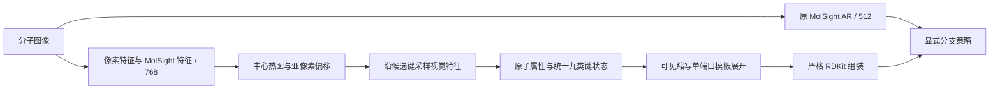

# MolSight 完整分子与环肽：结构性修复与真实评估

2026-11-12。仅完整小分子、线性多肽、环肽；不使用 SELFIES，不引入 Markush 推断。当前仍未解决真实专利环肽通用解析，不能把合成开发集成绩视为真实图成绩。

## 实际修改

保留原 MolSight 编码器、AR 解码器及 104 token 词表，所有 backbone 参数和 buffer 冻结且逐字节核验。新增像素定位与图读取头：

- 用中心热图替代不稳定的查询匹配；推理不接收参考原子数、坐标、顺序，不截断为参考数量。
- BondTube 直接读取候选键沿线及两侧图像特征。化学键与楔线方向统一为九类，反向配对显式置换，避免两个独立头互相矛盾。
- H 标签使用总化学氢，消除 SMILES 序列化习惯造成的监督冲突；禁止通过搜索氢数、删边或价态修补挽救输出。
- 对 CF3、OMe、Boc 等绘制单元建立可见图监督，按固定注册模板展开。隐藏原子位置是派生布局，不能声称为从像素检测出的坐标。
- 缩写匹配查询与展开模板统一；修正默认 iBu 匹配语义与本地展开语义不一致的问题。在完整图上分配手性楔线后再收缩，禁止在丢失化学身份的 dummy 图上重新定义手性。
- 对齐原 MolSight 的白边裁剪、缩放、归一化，坐标同步变换；加入大字形残差支路。
- 训练使用带噪声参考坐标监督 reader，评估始终由预测峰定位。参考坐标 ablation 仅为诊断，不计入端到端准确率。

## 数据与训练审计

1802 个训练身份、194 个固定合成开发样本。visible_data_v6 为 7122 个训练视图，视图不是新分子身份。按小分子/线性肽/环肽 40%/20%/40% 抽样，域内在可用原子数桶均匀抽样；该配比是训练设计，不宣称等同真实专利分布。

完整保留的更新链：Dense 5000 → 绘制风格 5000 → Visible 2000 → 修正数据后 Visible 6000，总计 18000 次头部更新。各 warmstart 明确重置优化器，不冒充精确续训。曾因四个越界观测坐标中断；未保存的 1287 步不计入更新链。四张图增大画布重绘，没有夹紧标签。

最终模型及优化器张量均有限；优化器步数 6000；原 backbone 差异为空。最终 checkpoint SHA256：`c0fb05a4636c071c3c5d5a8d0a4acb49317a3906a9096f09c422c6ab12661dd0`。

## 同图、带手性完整分子 exact

下表是固定合成开发集，非真实专利测试。阈值 0.5 在该开发集选择，所有域共用；随后独立图像推理复核。融合按预测结构选分支，不接收参考答案，但开发集成绩仍可能乐观。

| 方法 | 小分子 64 | 线性肽 64 | 环肽 66 | 总计 194 |
|---|---:|---:|---:|---:|
| 原 MolSight AR | 31 | 25 | 27 | 83 |
| 旧 sparse 图头 | 0 | 1 | 0 | 1 |
| 新 Visible 独立图头 | 21 | 47 | 47 | 115 |
| peptide_visible 显式融合 | 33 | 52 | 54 | 139 |

上述融合结果来自同图缓存组合；不能称为独立图头成绩。此前实际识别出 223 原子的合成环肽，不代表已覆盖真实复杂环肽。

## 真实 USPTO 5607 图

| 方法 | exact |
|---|---:|
| 原 AR 旧缓存口径 | 5100 |
| 原 AR 经相同结构解析和规范化口径 | 5101 |
| 新 Visible 独立图头 | 233 |
| preserve_ar 保守融合 | 5102 |
| cyclic_visible / peptide_visible | 5100 |

一条 AR 结果经缩写/结构解析后的芳香规范化与旧缓存判分不同，完整原文与标签保存在结果报告 `AR_scoring_contract_differences`。实际保守融合增益为同口径 **1**，不能声称比旧缓存提升 2。两个 specialist 策略各覆盖错两条原本正确的 AR 结果，因此保持 preserve_ar 默认，不切换为 specialist。

新图头真实肽候选 0/86、环肽候选 0/2；原 AR 分别 58/86、0/2。候选是结构启发式分组，两个环肽不足以建立通用能力结论。真实图中的密集残基文字、衬线字体、特殊环布局是观察到的分布差异；尚未通过消融证明每种差异的因果贡献。两张环肽目前均在严格组装时出现碳价态 5 错误，不能靠自动改键掩盖。

真实失败分组还包括 1680 条原子电荷/同位素/H/自由基状态与严格验证不一致、1029 条价态异常、932 条芳香键与非芳香原子冲突、694 条 Kekulé 失败。后续应独立实验联合化学一致性监督；当前尚未实现或验证该损失，不能声称增强字体即可解决。

## 资产与验证

根目录：`/home/dahuilangda/molsight_work/molsight_dense_v1/`。

- 模型：`artifact_visible_final_v1/`；开发阈值：`calibration_final_v1/policy.json`。
- 参数审计：`visible_clean_v1/final_parameter_statistics.json`。
- 独立开发推理：`validated_194_final/`；真实推理：`uspto5607_visible_final/`。
- 融合报告：`hybrid_194_final/report.json`、`hybrid_uspto5607_final/report.json`。
- 仓库汇总：`output/ocsr_audit_2026-11-12/visible_results.json`。
- 本次 dense、visible、spatial 测试实际执行：62 passed。

下一轮补充衬线/无衬线字体及非结构编号的受控绘制视图，开发图字节保持不变；仍需用独立真实环肽数据验证，不能继续针对这两张测试图调参。

## 后续数据阶段（独立于已报告模型）

`patent_styles_v4` 已完成 3604 张新增绘制，零拒绝；在绘制时交替使用 Liberation Sans / Serif 并记录字体文件 SHA256，增加 `(I)`、`(II)`、Compound / Example 编号。所有坐标均取自实际绘制，完整手性图经往返校验。合并既有可见缩写视图形成 `visible_data_v7`：7122 训练视图、194 开发图；验证图字节与上一阶段完全一致。该阶段并未加入测试图片或从测试参考标签生成训练分子。

此次增强只覆盖字体和图外编号，并未模拟真实图中沿环分布的残基注释。应将下一阶段看作受控数据实验，不能先验宣称解决了真实域差距。

化学一致性损失的下一项实验应固定数据、初始化、采样顺序和更新数，与纯监督基线配对；分开考察原子状态、芳香性、键级和带手性完整图 exact，避免用价态通过率替代识别准确率。推理仍应拒绝矛盾输出，不使用规则改键把错误图变成另一张合法图。

`preflight_typography_v1` 三步零学习率预检通过，包含实际缩写和 390 原子环肽；`typography_run_v1` 已从 retained 18000 步权重启动 1000 步独立训练（优化器重置），结果待验证，不计入上面的已完成模型成绩。日志：`typography_v1_logs/train.log`。

### 字体阶段最终结果

`typography_run_v1` 已完成 1000 步，同一阈值 0.5、同一 194 开发图：小分子 22/64、线性肽 39/64、环肽 33/66，总计 94/194。相比上一版 21/47/47，总体退步，**不提升为新默认模型**。环肽原子 F1 仍为 0.9971，而原子数完全正确仅 35/66；需联合核查漏点与下游完整图误差，不以高 F1 掩盖 exact 下降。该实验改变多个绘制因素，只能说明这一组合和训练设置未通过验收，不能独立归因于衬线字体。

最终参数审计完成：backbone 零差异，所有模型及优化器张量有限，优化器步数 1000。参数正常不等于泛化正确；这次失败更不能用数值正常作为通过理由。保留上一版 `artifact_visible_final_v1` 和其保守融合默认策略。下一项应在固定初始化和样本序列下做化学一致性监督与分辨率/定位召回的配对实验，仍以每个域完整图 exact 联合验收。
