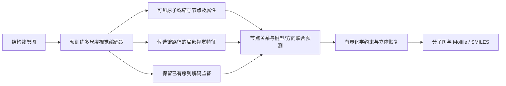

# 小分子、多肽与环肽识别：根因审计与重启方案

审计日期：2026-11-11。范围：本地源代码、正在运行的作业配置、已有数据清单与评测产物，以及作者论文和官方实现。本次没有启动训练、模型推理或额外分子生成，没有停止、修改已有训练/生成进程。新增的只有本文和 CPU 审计脚本、报告。

证据目录：`output/ocsr_root_cause_audit_2026-11-11/`。`reproduce.py` 用 AST 提取实际 focal 函数，复现匹配代价和去噪梯度；只读 Arrow 数据，重建当前采样和分组。`audit.json` 保存时间、配置、来源 SHA256、计数和复现结果。数值对应报告时间，不代表后台任务之后的状态。

## 1. 结论

**不能把当前瓶颈归结为“3700 张不够，增加到 9654 张就可以继续推进”。** 已确认训练配置与进度叙述不一致、两处训练信号错误、留出集同分子泄漏、oracle 条件与独立识别混用，以及检测器到完整化学结构的输出契约缺失。修正这些之前，继续增加训练步数不能形成可解释的扩容实验。

目标应是一个从实际图片独立恢复完整分子图的模型，覆盖小分子、线性和多种环化/修饰多肽。首尾环化的两个合成 strata 无法代表这个目标。SMILES 是输出格式之一；它与显式图预测并不互斥。现有证据既不能证明“SMILES 路线已被根本否定”，也不能证明“新空间检测器已经是可用主干”。

工程资产仍有价值：已有预训练权重、320,577 条 complete 训练记录、9,684 条有坐标来源的多肽训练图、坐标/原子对齐、渲染与质量检查、多种图比较工具，都可以复用。需要把它们接成可检验的学习系统。

## 2. 已确认的事实与缺陷

### 2.1 stage5d 实际没有完成宣称的扩容

现场进程 `/data/molsight_venv/bin/python -I stage5d_detect.py` 的 cwd 是 `/home/dahuilangda/molsight_work/molsight_spatial_graph_v1`。对应源文件：

- 第 45 行：`TRAIN_PATENT, TRAIN_OTHER, HELDOUT = 2900, 800, 30`。
- 第 46 行：`UPDATES = 80000`。
- 日志：`train_cached_ready=3700`，`heldout_cached_ready=30`，`val_cache_ready=63`。
- 文件头仍写着 stage5c。不是 9,654 张、100,000 步。

9,684−30=9,654 只能解释一个计划中的排除数量，不能证明该计划已执行。原子坐标清单确有 9,684 行，但它们不是 9,684 个独立分子：按源 Arrow 的 SMILES 字符串去重为 **4,847**，关联 component 为 **4,844**。这两个口径不相同，不能随意互换。

当前 3,700 行仅来自 peptide 域，去重为 **2,414 个 SMILES / component**。“other 800”仍是其他多肽 strata，**不是小分子回放**。complete 域的 320,577 行存在于数据清单，但未进入这个检测器的采样。

### 2.2 去噪负样本被实际训练成正样本：P0

`stage5d_detect.py:308–310`：

```python
dn_cls_target = torch.zeros(dn_class.shape[0], device=DEVICE)
dn_cls_target[:pos_count] = 1.0
dn_cls_loss = focal_binary_loss(dn_class[0], dn_cls_target)
```

`dn_class` 是 `[batch, query]`，当前为 `[1,64]`。`shape[0]` 是 batch=1；目标变成 `[1]`，被填为 1 后广播到所有 64 个 query。原定 32 个正样本和 32 个随机负样本，实际全部是正样本。

直接提取源函数的 CPU 梯度复现：一个随机负 query 在零 logit 时，实际梯度约 **−0.001165**，优化将提高其 objectness；正确负标签的梯度约 **+0.003496**，优化应降低它。方向相反。这是确定的实现错误，但其对最终准确率的影响量仍需重训消融。

修复应使用与预测完全相同的目标 shape，并对 shape、正负数量和梯度方向做断言。随机“负点”也须检查是否落到真实原子附近，否则依旧存在标签噪声。

### 2.3 Hungarian 分类代价的符号错误：P0

`stage5d_detect.py:61–65` 的 focal 代价相当于 `positive_cost + negative_cost`。DINO 官方 matcher 使用 `positive_cost - negative_cost`。

固定所有坐标相同，只改变 objectness：

| 概率 | 当前代价 | DINO 的差值代价 |
|---|---:|---:|
| 0.05 | 0.6760 | 0.6758 |
| 0.50 | 0.1733 | −0.0866 |
| 0.95 | 2.0278 | −2.0277 |

最小化当前代价会在这三者中选择 0.50，而非更可信的 0.95。它给匹配分配了错误的分类偏好，并与正分类监督冲突。定位损失还在起作用，所以不能简单描述为模型完全没有学习；但不应带着这个错误做规模结论。

依据：[DINO 官方 matcher，第 71–73 行](https://github.com/IDEA-Research/DINO/blob/main/models/dino/matcher.py)。

### 2.4 30 张 heldout 中 24 张同分子进入训练：P0

脚本按行 shuffle，然后取前 30 行作为 heldout；其余行取训练样本，没有按 component 或分子身份分组。用 seed=53 和实际 Arrow 重建后：

- heldout 共 30 行、29 个 component。
- **24 行的 component / 相同 SMILES 也存在于训练集**。
- 这可作已见分子的另一个视图诊断，不能作新分子泛化证据。

这项发现针对脚本额外切出的 30 行 heldout。**不等于已发现独立 63 张 validation 与训练泄漏**；对 63 张应另做来源/结构族审计。它已被反复用于选头、损失、阈值和 checkpoint，因而是开发集，不能再称盲测。

修复：在 image、相同分子、组成/修饰族、专利族和派生渲染的关联 component 上划分；训练脚本直接消费冻结的 split，不自行随机切图。

### 2.5 三种结果需要分开

| 已有结果 | 实际条件 | 能证明什么 |
|---|---|---|
| stage5b `atom_f1_mean=0.5205`，0/63 组装成功 | 检测定位由模型预测，但这个 atom F1 使用真实原子数 top-k；另有 threshold 组装分支 | 原子定位/筛选远未满足完整图需要；不是独立原子数预测的 F1 |
| focal reader 29/63 拓扑、28/63 带立体 exact | `canonical_eval.py` 把 `item['points']` 真实坐标传给 `run_reader` | 在已知原子位置的合成开发图上，键/元素/楔键读取已有信号 |
| MolSight AR：大型环肽 0/63 → 1/63 | 图像自由解码；500 步 char+edge 微调 | 该配方、预算下改进很小，不能推出所有预训练序列/图生成模型不可行 |

特别注意：detector 与 oracle reader 是不同模块、不同权重。两者差距不能直接量化成“只剩检测问题”。必须在统一模型上做 oracle 替换阶梯实验。

`stage5b_diag63.log` 的 24 个 detection_f1 / 39 个 sanitize 错误是顺序门控归因：低于 F1=0.5 的样本直接跳过后续阶段。不是独立因果分解，更不能把 39 个全部当成 RDKit 的问题。

`stage6k.log` 的 137 条 extra / 7 条 missing 来自真实坐标 reader 的**原始 argmax 图，未按最终 valence-greedy 结果重新计数**。它提示假阳性重要，不能外推为 detector 的错误分布。`canonical_comparison.json` 的 chord_fp=0 / missing=0 在旧设计文档中已承认为未测量占位，不能引用为零错误。

### 2.6 当前 detector 尚不能表达目标范围内的完整分子

当前 416 个 query 能容纳坐标清单中最多 390 原子的样本，当前失败不能先归因于 query 数量不足；未来更大分子则需另行支持动态容量或分层关系。它输出 objectness、坐标、atomic number 和化学键 logits；单键的三个通道还是相同 logit 的副本。当前 detector 的组装没有楔键/E-Z恢复、formal charge、同位素、显式 H / `[nH]` 等路径。独立 wedge head 仅存在于另一套 oracle reader 实验，并没有自动接到 detector。

因此，“等检测准确后自然得到完整立体分子”不成立。对包含已指定手性的样本，即使检测全对，当前 detector 组装仍没有足够信息恢复标签中的立体状态。`Chem.MolToSmiles(..., isomericSmiles=True)` 不会凭空产生未赋值的手性。

方向：预测元素之外的原子状态，保留有向楔键及端点，恢复双键几何；让视觉标签、化学状态和最终分子图之间有明确转换。芳香 N 的 H 状态应是状态推断的一部分，而不以遍历 2^N 种 H 组合为主架构。

依据：[RDKit Book 的芳香性与立体章节](https://www.rdkit.org/docs/RDKit_Book.html)。

### 2.7 评测解码不一致与实验追溯风险

- 训练 `chemical_edge_sums` 合并单键的 1/5/6 三类；stage5 evaluate 也合并，但 `stage5b_diag63.py` 对原七类直接 argmax。最小数值复现能让同一组 logits 在两条路径分别判成双键和单键。诊断应复用同一化学类别转换。
- 当前 `CoordFourierEncoder` 没有 sin/cos，只把 x/y 乘不同常数后投影，注释所称 Fourier 改造尚未真实落地。它并非完全无位置能力，但不能据注释推断实现具有多频位置基。
- stage5b/c/d 向同一 `detect2.pth` 写入。现有 `detect2_report.json` 描述 60k、seed47 的旧 run，当前源配置和实际 `detect2.pth` 内配置均为 80k、seed53；旧报告不能与这个文件名自动绑定。
- 保存内容没有实际已完成 update、optimizer、scheduler、RNG 或明确样本 split 清单，不能可靠精确续训。
- 2,500 步门槛被放在“每 5,000 步或第 1 步”分支内部，不会执行。5,000 步门槛只是打印 pass，并不停止训练。注释称失败自动 stop，实际并未实现。

这些是实验系统正确性问题，修复优先于另起一个 stage 名字。

### 2.8 40K 生成预计与 deadline 语义不符

早期现场日志为 450/40000，1,121 秒，约 1,445 个/小时；线性外推 40K 为 **27.7 小时**，8 小时约 11.6K。只是早期吞吐外推，之后分子难度、失败、争抢资源都会改变速度，不能承诺完成时间。

`engine_corpus.py` 把 `deadline_seconds` 原样传给**每个分子**的 `depict_record(...time_budget=...)`；Pool 外层没有总作业 elapsed-time 截止条件。`--deadline-seconds 28800` 不是整批 8 小时后停止。

生成产物标记 `training_admitted=False`，只保证布局阶段，还需最终输入分辨率的渲染、可读性、标签/坐标/立体一致性、分组去重与 admission。不能把 SVG 文件数量直接算成可用训练图。

## 3. 不能用已有证据推出的结论

1. “检测器从零至少必须数万张”没有统一阈值。是否需要数万取决于预训练能力、标注、任务覆盖、分辨率和学习曲线。当前是预训练视觉 encoder + 新初始化检测/图头，而非整个模型从零。
2. 失败的 500 步联合微调不证明 SMILES 生成必然不适合多肽。它同时存在辅助头未学好、训练曝光和分辨率等混杂。MolScribe、MolNexTR、MolSight 的官方工作已展示预训练原子/序列与图监督组合可行，不能用本地一个优化失败否定整个类别。
3. “MLP 单图未记住”不能证明 decoder hidden 没有图信息。需要检查标签/原子对齐、特征可区分性、梯度、优化和容量，并以相同信息输入做对照；成功的其他模型并非对这条结论的支持。
4. oracle 坐标几何规则 endpoint F1≈0.973 不代表没必要看图。它恰好说明单一等键长合成引擎提供很强的捷径；typed F1 和跨绘图引擎测试才更有辨别力。
5. MolNexTR 原论文使用 1M PubChem + 0.68M USPTO，数字属实，但图精确识别不是 COCO 对象检测，不能按 DETR 的图数/epoch 类比反推出训练充分性。
6. 公开 USPTO 的 connectivity、保留 tetrahedral chirality、完整 stereo exact 口径并不相同；不能直接把各论文 headline 数字拼成排名。近期 Glyph 官方实现特意同时报告三种口径，也提醒应复核测评语义。新模型需作为同图 baseline，尚无本地环肽成绩。

文献：[MolScribe](https://github.com/thomas0809/MolScribe)、[MolNexTR 作者论文](https://pmc.ncbi.nlm.nih.gov/articles/PMC11654183/)、[MolSight 作者论文](https://arxiv.org/html/2511.17300v1)、[Glyph 官方实现](https://github.com/EdisonScientific/glyph)。

## 4. 建议的目标架构与基座选择

推荐主线：**复用已预训练的完整识别能力，在统一模型上做图像到分子图的联合适配。** 原子级图覆盖小分子、非天然/修饰多肽与环肽，不把多肽强制化成固定氨基酸序列。HELM/残基分解可作为派生输出和辅助诊断。

逻辑结构：



这是待验证设计，不是已经实现或保证有效的架构。

### 4.1 先复用真正预训练过的节点/键能力

将可训练的 MolNexTR 或 MolScribe 图路径作为首要 warm-start 候选；保留现有 MolSight 作为同图监督 continuation 对照。选型取决于小规模受控比较，不预先宣称哪种模型获胜。已有的 MolNexTR 推理适配代码不等同于官方训练入口完整可用，必须先核对 state dict、词表、预处理、原子顺序与训练接口。

不能忽略 MolNexTR 的 384px / 64 坐标 bins：官方训练脚本记录了这一设置。稠密大分子缩到 384 时细节可能消失，64-bin 定位也可能不够细；仅放宽 max_len 并没有修复视觉读取问题。扩分辨率和位置/坐标表达需保留旧词表 ID、严格迁移并训练适配，不能随机替换嵌入或靠推理时插值宣称解决。

当前新 DETR 头可保留为受控候选，但不再作为“只要喂图就能工作”的唯一主线。若 warm-start 图模型胜出，应停止并行无限修补未达标分支。

依据：[MolNexTR 官方训练配置](https://github.com/CYF2000127/MolNexTR/blob/main/exps/train.sh)。

### 4.2 真正的视觉落地比单纯几何关系重要

- 根据实际输入中最短键、字号和楔线保真度做分辨率分桶；小分子保留原生分辨率，大分子适配更高分辨率。
- 如需局部高分辨率，用共享 encoder 的多尺度特征与全图坐标融合；不独立生成各 tile 的 SMILES 再拼接，避免切断闭环。
- 节点特征之外采集候选键中间路径/条带的视觉证据，区分近邻未成键、交叉不连接、双线和楔线。仅端点距离很容易学成渲染器几何规则。
- 可比较高分辨率关键点 heatmap＋局部 offset＋候选图关系学习，减少小数据下 query 匹配的不稳定。MolGrapher 是这种分解的正式参考，不是该路线必然优于 DETR 的证明。
- 构建候选图时验证真实键召回，特别是闭环和不规则长键。近邻/距离仅作候选与软先验，不能硬删掉“较远的真正键”。

依据：[MolGrapher ICCV 论文](https://openaccess.thecvf.com/content/ICCV2023/papers/Morin_MolGrapher_Graph-based_Visual_Recognition_of_Chemical_Structures_ICCV_2023_paper.pdf)。

### 4.3 补齐语义与立体契约

可见节点图与展开后的化学图分开。一个 Ph/Boc/残基缩写不在图像里提供所有展开原子的位置；缺失位置应有 mask，不允许编造坐标监督。上下文不明的缩写保留歧义，别用常见肽结构补猜。

图输出至少覆盖原子元素、charge/isotope、显式 H/芳香状态、键型、有向楔键与双键立体信息。确切 schema 可以通过 atom-token 状态输出或多头实现，不要求所有字段都另造一个模块。

约束解码用于排除不可能的候选；它不能给错误视觉预测颁发正确证书。分别报告原始输出、约束后输出和拒识率。不得以删键后能 Sanitize 作为 exact 成功。

## 5. 数据扩容应扩什么

先使用已有资产建立可信学习曲线，再扩新实体和真实视觉覆盖，而不是默认立即再开十万图生成。

- **基础 complete**：清理并选取已有 320,577 行中的有效记录做小分子保留；为关键点/坐标任务只接纳真有位置证据的样本，不能把 SMILES-only 数据伪装成坐标监督。
- **多肽化学覆盖**：线性、首尾环、二硫键、lactam/lariat、分支、多闭环、N-甲基、D/非天然单体、depsipeptide 等。两个首尾环 strata 的 40K 不等于这些覆盖。
- **视觉覆盖**：独立绘图引擎、真实专利/论文风格、局部拥挤、非均匀键长、字号/字体、图号和裁剪干扰、扫描退化。每种变化都必须保留可识别信息。
- **真实监督**：优先建立来源可核对的少量高价值真实长肽/环肽训练与独立测试；别用另一识别器的输出直接当真值。合成产生局部标签很便宜，化学/绘图质量和真实图人工复核仍有成本。
- **hard negatives**：近距离非键、跨环假键、芳环邻近原子、漏/重复残基、错误闭环、N-甲基遗漏、手性反转。它们用于局部边监督和候选排序，不替换原图的正确标签。

数量计划建议从独立实体的 1K / 4K / 16K / 64K 档学习曲线做起，先证明最小两档学习有效。每档报告分子数、component 数、渲染图数、实际曝光和 GPU 时间。既比较相近收敛状态，也比较固定计算预算，防止更多数据却每个实体更少训练。

当前 batch=1，80K 步只有约 80K 次抽样。增到 40K 图仍只训练 100K 步，平均仅 2.5 次/图，并不自动成为充分训练。step 数与别人的 batch256 训练不是同一尺度。

真实评测可以先立一个可审阅的小规模版本，再扩到约 1,000 图（例：300 小分子、300 线性肽、400 环肽；具体配比按产品输入决定）。这是工作量规划，非文献规定的最低样本数。按来源族聚类统计置信区间，困难子组独立报告，测试集不反复选阈值。未知历史预训练重叠必须披露。

依据：[MolRecBench-Wild 作者论文](https://arxiv.org/html/2605.05832v1)提供真实来源与视觉/语义难度联合分层的参考；其结果不等于本项目环肽上的结果。

## 6. 训练和验收要按可证伪的顺序推进

| 阶段 | 动作 | 继续/停止依据 |
|---|---|---|
| R0 实验可信性 | 归档现有 checkpoint、源码/配置/数据/split 哈希；修 focal、DN、解码和 checkpoint 协议 | 单元/梯度检查通过；图/分子跨 split 重叠为零；保存重载和续训可复现 |
| R1 小集可学习性 | 选 16–32 张，覆盖小分子、线性肽、稠密环肽与立体状态，联合监督过拟合 | 从图片自由推理能近乎记住训练集全图；失败则回查监督、分辨率与优化，不扩容 |
| R2 同模型 oracle 阶梯 | 同一 checkpoint 比较 image-only、gold-n、gold-xy、gold-xy+元素、gold-graph+预测 stereo | 定量定位原子数、位置、属性、键或立体瓶颈；不把不同模型分数混为阶梯 |
| R3 小规模主线对照 | 同 split、真实输入、预算和正确性协议，比较 warm-start 图模型与 MolSight 联合微调；新检测器为受控候选 | 同时报训练/验证，多个种子或配对区间；按独立整图性能与成本选主线 |
| R4 联合适配与扩容 | 新头先稳住；随后有实际梯度的 encoder+decoder 联合微调，保留小分子标签回放，分辨率分桶 | 随数据规模增长有真实泛化收益；小分子无不可接受回退，真实图优于基线 |
| R5 部署验收 | 实际裁剪、预处理、阈值/解码与服务完全一致，不使用任何 GT 线索 | 原始立体 exact、覆盖率/拒识、延迟/显存、来源外泛化均达到事先约定标准 |

R1 的“近乎记住”是排除实现失败的工程闸门，不是泛化成绩。R2 的 oracle 仅作诊断，不进入产品成功率。所有候选应共享失败分母，不能跳过异常/不可解析样本。

验收至少包括：真正 image-only 的原子计数误差、最优一对一匹配的位置 precision/recall、元素/状态准确率、typed bond precision/recall、整图 connectivity exact、包含 stereo/charge/isotope/components 的完整 exact、真实 EOS、分层来源指标与资源消耗。距离容差按键长/实际像素报告，不只用固定图幅百分比。原子均值 F1 和 exact 都要报，前者无法代替后者。

长图误差会积累：仅作独立误差的示意，300 次决策各自 99% 正确时全对概率约 4.9%。现实误差有关联，不能用这个公式预测准确率；它解释为何“局部 F1 看上去很高”仍会大量整图失败。200 原子的全对候选中约有 20K 无向原子对，无键假阳性即使只有 0.1%，也可能产生约 20 条伪边；必须看假阳性和整图指标。

RL 置于有效监督之后。先证明模型能产出可靠的局部结构和接近正确的完整候选，再比较同算力监督 continuation 与 RL。不能让 fingerprint 相似度奖励掩盖错误闭环或错误立体。

## 7. 当前资源与执行建议

现场是两张 RTX 4070 Ti SUPER，单卡 16GB；不能按一张 32GB 卡规划。高分辨率/长分子先实测激活显存、padding 和每 GPU 小时有效更新，再定 batch、累积、checkpointing。冻结 encoder 缓存适合隔离头部实验，不应永久代替视觉适配；它无法通过梯度修复丢失的细线特征。

建议把当前有 P0 问题的 stage5d 归档后终止其“正式扩容实验”身份，修复和小集闸门通过后再开新 run；这是研究建议，本次没有执行进程终止。生成资产可保留，但应按可测覆盖缺口和实际吞吐安排，避免把全部 CPU 用在单一引擎布局上。当前训练中大量 Python 原子对循环、CPU/GPU 同步和重复前向值得 profile；低 GPU 利用率本身还不能证明具体瓶颈。

每个 run 使用独立不可覆盖的目录，保存真实已完成 update、optimizer/scheduler、RNG、采样位置、预处理/词表/化学比较版本、源码和 split 哈希。日志必须描述实际配置，停止条件必须真的执行。先做到实验结论可追溯，再谈自动过夜迭代。

最终建议：**先修训练和评测的可信性，再用预训练图识别能力建立统一、具有视觉证据的原子/键/立体学习路径；数据扩容围绕独立实体、真实风格和缺失能力展开。** 当前资产足够启动这套受控重启，但还没有证据支持“再加 40K 同类合成图就能解决通用识别”。
